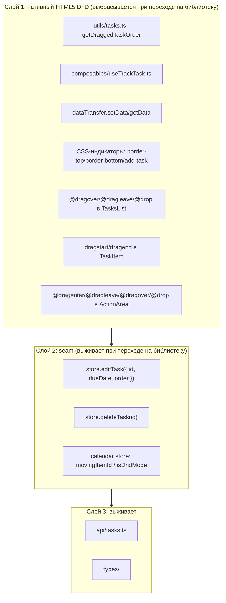

# Этап 6: Drag-and-Drop

**Сложность:** Высокая
**Блокирует:** Этап 7 (финальная интеграция)
**Зависит от:** Этап 3 (TasksList/TaskItem), Этап 5 (Calendar views)

---

## Принятые решения

| # | Решение | Обоснование |
|---|---------|-------------|
| 1 | **`movingItemId` в calendar store (Pinia)** | DnD — часть календарного контекста; `MovingItem` уже объявлен в `types/calendar.ts`; перенос 1:1 с React `CalendarContext`. Отдельный DnD-store не оправдан (один потребитель). |
| 2 | **Элемент не хранится; очистка по `dragend { once: true }` в источнике drag** | DOM-узел в Pinia state → глубокий Proxy (антипаттерн Vue). Устраняет течь слушателей из legacy (`context.tsx:86`). `{ once: true }` гарантирует однократный вызов. |
| 3 | **Emit-цепочка `itemDragStart` удаляется; компоненты вызывают store напрямую** | С Pinia любой компонент читает store без проброса. Цепочка TaskItem→TasksList→CalendarWeek/Month→Calendar была нужна только для доступа к React Context. В Vue она избыточна и **не работает для unplanned** (TasksForm — сосед Calendar в MainPage, событие до него не доходит). Требуется правка закрытого Этапа 5. |
| 4 | **`ActionArea.vue` расширяется drag-обработчиками на этом этапе** | Delete-zone и toggle-period zone требуют `@dragenter/@dragleave/@dragover.prevent/@drop` + локальный `hovered` ref. Через `defineEmits` (соглашение проекта). Без `@dragover.prevent` drop не fires вообще. |
| 5 | **Delete zone и toggle-period zone переносятся из legacy** | Полная функциональность DnD. Toggle через `setTimeout(200)` — parity с legacy (переключение периода во время drag может отменить сам drag в ряде браузеров; осознанно сохраняем поведение). |
| 6 | **Composable — тонкий `useTrackTask`; DnD-логика ниже границы store запрещена** | Seam для будущей библиотеки: store actions (`editTask({id, dueDate, order})`, `deleteTask(id)`) выживают при переходе на SortableJS/vuedraggable; нативные обработчики, dataTransfer, индикаторы CSS — выбрасываются целиком. Толстый composable был бы leaky abstraction (форма возврата `position` протечёт под библиотеку). |
| 7 | **`dragleave` — relatedTarget guard; `setTimeout(200)` — parity** | Legacy мигание индикаторов при переходе на дочерний элемент чиним проверкой `relatedTarget instanceof Node && root.contains(relatedTarget)`. Осознанное расхождение с legacy (визуальный баг). `setTimeout(200)` оставляем как есть (parity). |
| 8 | **Unplanned участвует в dnd-mode (расхождение с legacy)** | В legacy `TasksFormContainer` вне `CalendarProvider` (`pages/main/component.tsx:23-30`), поэтому drag из unplanned не ставит `.dragged` и не показывает delete-zone. Во Vue с глобальным store это ограничение снимается автоматически. Фиксируем как осознанное улучшение. |
| 9 | **`.mini` включён в Этап 6 как prop** | CSS-класс сирота (`TaskItem.vue:171-178`), не принадлежит ни одному этапу. Prop `mini?: boolean` пробрасывается `CalendarMonth → TasksList → TaskItem`. Unplanned не получает prop → точный parity с legacy. Чтение из store привело бы к утечке в unplanned при month-view. |

---

## Архитектура DnD



Правило: компонентам разрешено выражать результат DnD **только** как вызов action из слоя 2. Никакой DnD-логики ниже границы store.

---

## Задачи

### 6.1 Calendar store: `movingItemId`

**Файл:** `src/stores/calendar.ts`

**Изменения state:**
```ts
interface CalendarState {
  date: Date
  period: CalendarPeriod
  movingItemId: string | null  // новое поле
}

state: (): CalendarState => ({
  date: new Date(),
  period: CALENDAR_PERIODS.week,
  movingItemId: null,
})
```

**Getter:**
```ts
isDndMode: (state) => state.movingItemId !== null
```

**Actions:**
```ts
setMovingItemId(id: string | null) {
  this.movingItemId = id
}
```

**Типы:** удалить интерфейс `MovingItem` из `src/types/calendar.ts` (поле `element` больше не используется; предложение по улучшению TS — подтверждено решением #2).

**Тест:** `src/stores/__tests__/calendar.spec.ts`
- начальное состояние: `movingItemId === null`, `isDndMode === false`
- `setMovingItemId('task-1')` → `movingItemId === 'task-1'`, `isDndMode === true`
- `setMovingItemId(null)` → сброс

---

### 6.2 Composable `useTrackTask`

**Новый файл:** `src/composables/useTrackTask.ts`

> ⚠️ Директория `src/composables/` создаётся впервые.

```ts
import { ref } from 'vue'
import { getDraggedTaskOrder } from '../utils/tasks'

/**
 * Отслеживание позиции курсора внутри drop-зоны.
 * ВАЖНО: position — per-instance ref. НЕ выносить в модульный singleton.
 */
export function useTrackTask() {
  const position = ref<number | null>(null)

  function track(target: Element | null, clientY?: number) {
    if (!target || clientY === undefined) {
      position.value = null
      return
    }
    position.value = getDraggedTaskOrder(target, clientY)
  }

  return { position, track }
}
```

**Тест:** нет unit-теста (решение #4 индекса плана: jsdom плохо поддерживает `getBoundingClientRect`). Покрытие через component test-after в 6.4.

---

### 6.3 TaskItem: drag source

**Файл:** `src/components/task/TaskItem.vue`

**Добавить:**
```ts
import { useCalendarStore } from '../../stores/calendar'

const calendarStore = useCalendarStore()

const isDragged = computed(() => calendarStore.movingItemId === props.taskId)

function onDragStart(event: DragEvent) {
  if (!task.value) return
  const target = event.currentTarget as HTMLElement
  event.dataTransfer!.effectAllowed = 'move'
  event.dataTransfer!.setData('text/plain', props.taskId)
  calendarStore.setMovingItemId(props.taskId)
  target.addEventListener('dragend', () => calendarStore.setMovingItemId(null), { once: true })
}
```

**Template:**
```vue
<div
  v-if="task"
  class="task"
  :class="{ completed: task.completed, overdue: isOverdue, dragged: isDragged, mini }"
  :draggable="!task.completed"
  @dragstart="onDragStart"
>
```

**Props (новые):**
```ts
const props = defineProps<{
  taskId: string
  mini?: boolean  // решение #9
}>()
```

> Примечание: `event.currentTarget` обязан быть захвачен синхронно (становится `null` после dispatch). Cast обязателен (тип `EventTarget`).

**Стили:** классы `.dragged` и `.mini` уже определены (строки 140-142, 171-178); биндинг добавляется этой задачей.

---

### 6.4 TasksList: drop zone + визуальные индикаторы

**Файл:** `src/components/tasks/TasksList.vue`

**Удалить:** `defineEmits<{ itemDragStart }>()` (строки 16-18) — решение #3.

**Добавить:**
```ts
import { useTrackTask } from '../../composables/useTrackTask'
import { useCalendarStore } from '../../stores/calendar'
import Plus from '../icon/Plus.vue'

const { position, track } = useTrackTask()
const calendarStore = useCalendarStore()

const showAddIcon = computed(() => position.value !== null && taskIds.value.length === 0)

function onDragOver(event: DragEvent) {
  event.preventDefault()
  track(event.target as Element, event.clientY)
}

function onDragLeave(event: DragEvent) {
  const root = event.currentTarget as HTMLElement
  if (event.relatedTarget instanceof Node && root.contains(event.relatedTarget)) return
  track(null)
}

function onDrop(event: DragEvent) {
  const id = event.dataTransfer?.getData('text/plain')
  if (!id || position.value === null) return
  void store.editTask({ id, dueDate: props.dueDate, order: position.value })
  event.dataTransfer?.setData('text/plain', '')
  track(null)
}
```

**Props (новые):**
```ts
const props = withDefaults(
  defineProps<{
    dueDate: string | null
    emptyText?: string
    mini?: boolean  // решение #9, проброс в TaskItem
  }>(),
  { emptyText: 'Список пуст.' },
)
```

**Template:**
```vue
<template>
  <div
    class="tasks"
    @dragover="onDragOver"
    @dragleave="onDragLeave"
    @drop="onDrop"
  >
    <div v-if="isLoading" class="loading">Загрузка...</div>
    <div v-else-if="showAddIcon" class="add-task"><Plus size="medium" /></div>
    <div v-else-if="taskIds.length === 0" class="empty-text">{{ emptyText }}</div>
    <div data-tasks class="container">
      <TaskItem
        v-for="(taskId, index) in taskIds"
        :key="taskId"
        :task-id="taskId"
        :mini="mini"
        :class="{ 'border-top': index === position, 'border-bottom': index + 1 === position }"
      />
    </div>
  </div>
</template>
```

> Примечание о fallthrough: классы `border-top`/`border-bottom` применяются из родителя к корневому `<div data-task>` TaskItem благодаря автоматическому fallthrough атрибутов Vue. Scoped-атрибут TasksList также применяется к корню ребёнка — стили из TasksList.match ✅

**Стили (добавить):**
```scss
.add-task {
  fill: #d5d5d5;
  margin: 0 auto;
}

.container {
  div.border-top,
  div.border-bottom {
    transition: 0.2s all ease-in-out;
  }

  div.border-top {
    box-shadow:
      0 -2px 1px 0 #b3d4ff,
      0 2px 1px -1px rgba(black, 0.2);
  }

  div.border-bottom {
    box-shadow: 0 2px 1px 0 #b3d4ff;
  }
}
```

Источник стилей: legacy `packages/react-app/src/components/tasks/styles.module.scss:20-38`.

**B5 фикс:** `props.dueDate` передаётся явно (`string | null`). Для unplanned это `null`, что проходит через `JSON.stringify` и очищает дату на сервере (`api/src/utils.js:80`).

**Тест:** test-after (рендер классов при заданном `position` в store; рендер PlusIcon при пустом списке и ненулевом `position`). Нативные drag-события не тестируются (решение #4 индекса).

---

### 6.5 ActionArea: drag-события

**Файл:** `src/components/action-area/ActionArea.vue`

**Добавить:**
```ts
import { ref } from 'vue'

const hovered = ref(false)

const emit = defineEmits<{
  enter: [event: DragEvent]
  leave: [event: DragEvent]
  drop: [event: DragEvent]
}>()

function onDragEnter(event: DragEvent) {
  hovered.value = true
  emit('enter', event)
}

function onDragLeave(event: DragEvent) {
  hovered.value = false
  emit('leave', event)
}

function onDrop(event: DragEvent) {
  hovered.value = false
  emit('drop', event)
}
```

**Template:**
```vue
<div
  class="action-area"
  :class="{ dangerous, active: hovered }"
  @dragenter="onDragEnter"
  @dragleave="onDragLeave"
  @dragover.prevent
  @drop="onDrop"
>
  <slot />
</div>
```

> ⚠️ `@dragover.prevent` обязателен: без него drop не fires. `drop` объявлен в emits → fallthrough native listener отключается, работает только наш emit.

**Стили (добавить):**
```scss
&.active {
  background-color: #d5d5d5;
  transition: 0.1s all ease;

  &.dangerous {
    background: rgba(255, 0, 0, 0.4);
  }
}
```

Источник: legacy `packages/react-app/src/components/action-area/styles.module.scss:16-23`.

---

### 6.6 CalendarHeader: dnd-mode, delete zone, toggle-period zone

**Файл:** `src/components/calendar-header/CalendarHeader.vue`

**Добавить:**
```ts
import { CALENDAR_PERIODS } from '../../constants/calendar'
import { useTasksStore } from '../../stores/tasks'

const tasksStore = useTasksStore()

const isDndMode = computed(() => store.isDndMode)

function onTogglePeriodEnter() {
  // Parity с legacy: значение фиксируется ДО setTimeout,
  // иначе повторные dragenter могут поставить в очередь противоположные переключения.
  const target = store.isPeriodMonth ? CALENDAR_PERIODS.week : CALENDAR_PERIODS.month
  setTimeout(() => store.setPeriod(target), 200)
}

function onDeleteDrop(event: DragEvent) {
  const id = event.dataTransfer?.getData('text/plain')
  if (!id) return
  void tasksStore.deleteTask(id)
  event.dataTransfer?.setData('text/plain', '')
}
```

**Template:**
```vue
<div class="calendar-header" :class="{ 'dnd-mode': isDndMode }">
  <h1>{{ headerText }}</h1>
  <ActionArea class="action-toggle-period" @enter="onTogglePeriodEnter">
    <CaretUp size="medium" />
  </ActionArea>
  <ActionArea class="action-delete" dangerous @drop="onDeleteDrop">
    <Trash size="medium" />
  </ActionArea>
  <CalendarPeriodControls class="period-controls" />
  <CalendarDateControls class="date-controls" />
</div>
```

**Известное поведение (parity):** переключение периода во время drag уничтожает DOM-узел источника → drag operation cancelled → `dragend` fires → `movingItemId` cleared → dnd-mode exits. Воспроизводится как есть.

**Тест:** test-after (класс `dnd-mode` при `store.movingItemId !== null`; отсутствие класса при null).

---

### 6.7 Удаление emit-цепочки

| Файл | Изменение |
|------|-----------|
| `components/tasks/TasksList.vue` | Удалить `defineEmits<{ itemDragStart }>()` (строки 16-18) |
| `components/calendar-week/CalendarWeek.vue` | Удалить `defineEmits<{ itemDragStart }>()` (11-13); удалить `@item-drag-start` binding (24) |
| `components/calendar-month/CalendarMonth.vue` | Удалить `defineEmits<{ itemDragStart }>()` (18-20); удалить `@item-drag-start` binding (35) |
| `components/calendar/Calendar.vue` | Удалить stub `onItemDragStart` (10-13); удалить оба `@item-drag-start` bindings (23, 29); удалить eslint-disable comment |

---

### 6.8 Проброс prop `mini`

| Файл | Изменение |
|------|-----------|
| `components/calendar-month/CalendarMonth.vue` | Добавить `:mini="true"` на `<TasksList>` (строка 32-35) |
| `components/calendar-week/CalendarWeek.vue` | Не передавать `mini` (week-view не использует `.mini`) |
| `components/tasks-form/TasksForm.vue` | Не передавать `mini` (unplanned не использует `.mini`) |

> Примечание: в week-view `.mini` не нужен — задачи отображаются полноразмерно. В month-view все дни получают `mini=true`. Unplanned не получает prop → parity с legacy (где unplanned вне CalendarProvider и `isPeriodMonth === undefined`).

---

## Баги legacy

| Баг | Что относится к этапу | Фикс |
|-----|----------------------|------|
| B5 | Drop в unplanned передавал `dueDate: undefined` → `JSON.stringify` отбрасывал ключ → дата не очищалась | `props.dueDate` передаётся явно как `string \| null`; для unplanned это `null`, что проходит через JSON и очищается на сервере (`api/src/utils.js:80`) |
| B7 | `getNodeIndex` обходил `childNodes` включая текстовые узлы и использовал `return` внутри `forEach` (не прерывал обход) | Уже исправлено при портировании `getDraggedTaskOrder` на Этапе 0 (`utils/tasks.ts:8` использует `Array.from(tasksEl.children).indexOf(taskEl)`) |

---

## Расхождения с legacy (осознанные)

| # | Поведение | Legacy | Vue | Причина |
|---|-----------|--------|-----|---------|
| 1 | Drag из unplanned: `.dragged` на источнике | Нет | Есть | Unplanned вне CalendarProvider в legacy; в Vue глобальный store |
| 2 | Drag из unplanned: delete-zone в header | Не показывается | Показывается | То же |
| 3 | `dragleave` на TasksList | Сброс позиции без проверки `relatedTarget` → кратковременное мигание индикаторов | Проверка `relatedTarget instanceof Node && root.contains(relatedTarget)` | Визуальный баг legacy; решение #7 |
| 4 | Reordering внутри unplanned | Визуально не работает (сортировка по creationDate) | То же | Frozen API (`utils.js:30` пропускает reorder при falsy dueDate) + getter сортирует по creationDate. Вне скоупа. |

---

## Критерии завершения

- [ ] Задачу можно перетащить из unplanned в день календаря
- [ ] Задачу можно перетащить между днями
- [ ] Порядок задач сохраняется (optimistic update + server reorder)
- [ ] UI обновляется оптимистично (order −0.5 до ответа сервера)
- [ ] API синхронизирует изменения (single object или array response)
- [ ] При drop в unplanned дата очищается (B5)
- [ ] Визуальные индикаторы позиции (border-top/border-bottom) отображаются при drag over
- [ ] PlusIcon отображается при drag over пустого списка
- [ ] Класс `.dragged` (opacity 0.5) на источнике drag
- [ ] Header переходит в `dnd-mode` при drag (показывает delete-zone и toggle-period zone)
- [ ] Drop на delete-zone удаляет задачу
- [ ] Drag-enter на toggle-period zone переключает период (через setTimeout 200ms)
- [ ] `.mini` применяется в month-view и не применяется в week-view и unplanned
- [ ] Emit-цепочка `itemDragStart` удалена из всех компонентов
- [ ] Test-after для компонентов (классы dnd-mode, dragged, border-top/bottom, add-icon)
- [ ] `pnpm check` проходит (lint + format + type-check)
- [ ] `pnpm build` проходит
- [ ] Визуальное соответствие React версии (:5174 vs :5173)

---

## Порядок выполнения

1. Обновить `stage-5-calendar-views.md`: снять критерий строки 270, поправить решение #3 и задачи 5.6/5.7
2. Calendar store: `movingItemId` + `isDndMode` + `setMovingItemId` + тест
3. Удалить `MovingItem` из `types/calendar.ts`
4. Создать `composables/useTrackTask.ts`
5. TaskItem: `onDragStart`, `isDragged`, prop `mini`, биндинг классов
6. TasksList: `useTrackTask`, drag handlers, `showAddIcon`, prop `mini`, удаление emit, стили индикаторов
7. ActionArea: drag handlers, `hovered`, emit, стиль `.active`
8. CalendarHeader: `isDndMode`, `onTogglePeriodEnter`, `onDeleteDrop`, класс `dnd-mode`
9. Удалить emit-цепочку из CalendarWeek/CalendarMonth/Calendar.vue
10. Проброс `mini` в CalendarMonth → TasksList
11. Test-after для компонентов
12. `pnpm check` + `pnpm build`
13. Ручная визуальная проверка (dev:vue :5174 vs dev:react :5173)

---

## Проверка

```bash
cd packages/vue-app
pnpm test:unit     # тесты store
pnpm check         # lint + format + type-check
pnpm build         # собирается
```

Ручная проверка: `pnpm dev:vue` (:5174) + `pnpm dev:react` (:5173) параллельно.
- Перетаскивание задачи из unplanned в день → задача появляется в дне, исчезает из unplanned
- Перетаскивание между днями → dueDate меняется
- Reordering внутри дня → порядок сохраняется после refresh
- Optimistic update → задача мгновенно занимает новую позицию до ответа сервера
- При ошибке API → задача возвращается на прежнюю позицию
- Drop в unplanned → dueDate очищается, задача уходит в список «Список дел»
- Drag over → индикаторы позиции (синие тени)
- Drag over пустой список → PlusIcon
- Источник drag → opacity 0.5
- Header при drag → видны корзина и стрелка переключения
- Drop на корзину → задача удаляется
- Drag-enter на стрелку → через 200ms переключается период
- Month-view → задачи компактные (.mini); week-view и unplanned → полноразмерные

---

→ [Этап 7: MainPage и финальная интеграция](./stage-7-main-page-integration.md)
